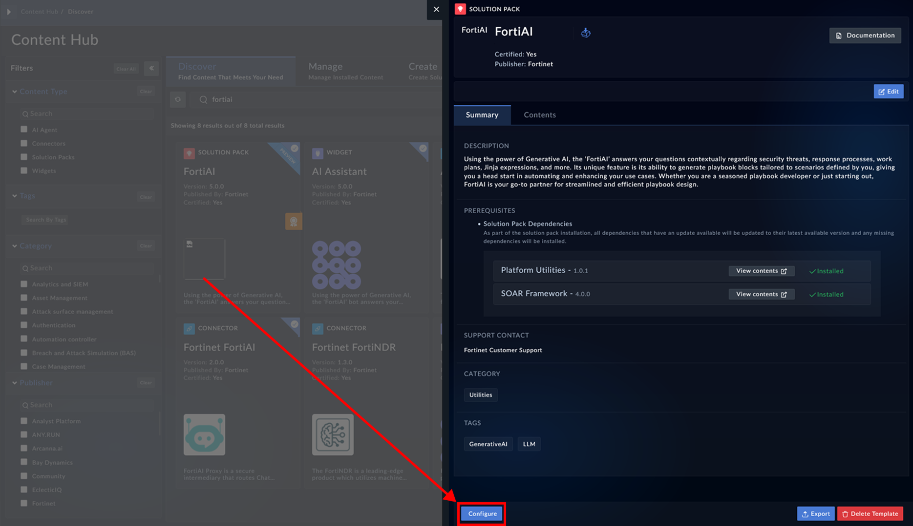
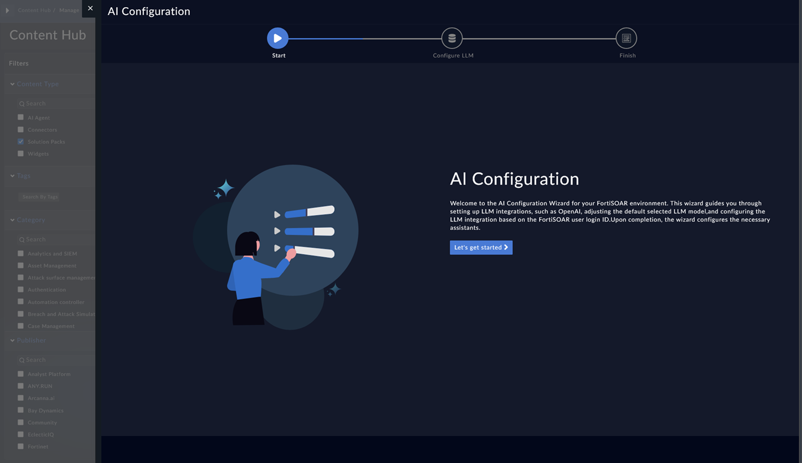
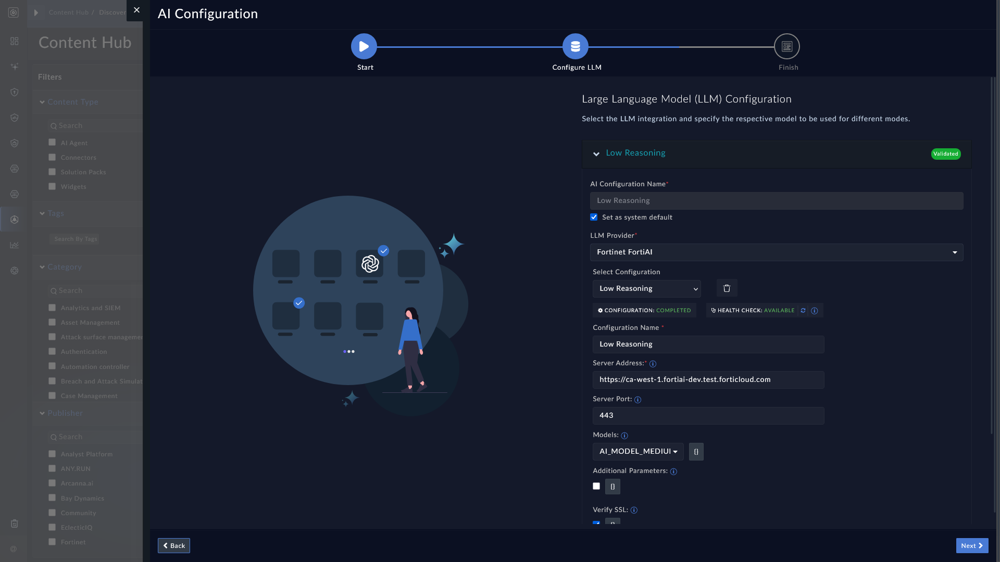
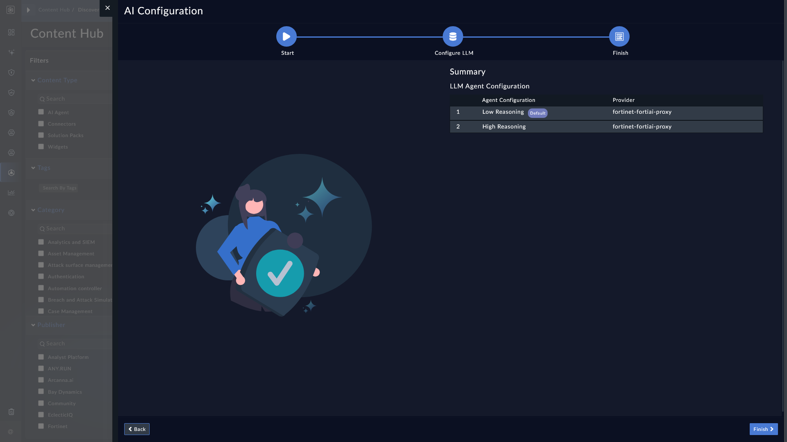

| [Home](../README.md) |
|----------------------|

# Installation

The FortiAI solution pack is installed by default in FortiSOAR v8.0.1. To reinstall it, for example after an accidental removal or during troubleshooting, follow these steps.

1. In FortiSOAR, click **Content Hub** > **Discover**.
2. Search for **FortiAI** in the solution pack list.
3. Click the **FortiAI** solution pack card.
4. Click **Install** at the bottom of the screen.

## Prerequisites

Complete the following prerequisites before you use the solution pack.

### Dependent solution packs

The solution pack requires the following solution packs.

| Name               | Type          | Version          | Purpose                             |
|--------------------|---------------|------------------|-------------------------------------|
| SOAR Framework     | Solution Pack | v4.0.0 and later | Required for case response modules. |
| Platform Utilities | Solution Pack | v1.0.0 and later | Required for the Key Store module.  |

### Token entitlement

FortiAI consumes tokens from the entitlement attached to your FortiCare account.

- A production or evaluation license includes five million tokens per month. The allowance resets on the first of each month for as long as the license remains active. Unused tokens do not carry over.
- Default tokens are tied to the license SKU. Add-on tokens are tied to the FortiCare account.
- Purchase additional tokens through FortiCare.

The **Fortinet FortiAI** connector is configured automatically. No manual credential configuration is required.

> [!Note]
> Trial licenses do not include a token allowance. On a trial license, FortiAI returns the error `Failed to load tokens.`

### Enabling AI features

Before the FortiAI solution pack can be used, an administrator must enable AI features in FortiSOAR system settings.

1. Go to **Settings** <picture><source media="(prefers-color-scheme: dark)" srcset="./res/icon-settings-light.svg"><source media="(prefers-color-scheme: light)" srcset="./res/icon-settings-dark.svg"></picture>.
2. Click the **FortiAI** tab.
3. Select the **Enable AI Features** toggle and click **Save**.
4. In the confirmation dialog, click **Acknowledge**.

Enabling AI features adds the **AI Configurations** section to the **Settings** menu. For details on configuring MCP servers, prompts, organizational context, and insights, see [AI Configurations](./ai-configurations.md).

> [!Note]
> Token usage information is displayed on the FortiAI page. For details on token allocation and usage, refer to the [FortiAI topic](https://docs.fortinet.com/document/fortisoar/8.0.0/administration-guide/249178/introduction) in the Administration Guide.

### Enabling advanced development features

To allow users to import or upload custom AI agents, create custom connectors, or create custom widgets, an administrator with **Security Update** permission must provide explicit consent through the **Advanced Development Features** tab.

> [!Warning]
> These capabilities can introduce unverified code into the environment. Review the associated risks before enabling them.

To enable import or upload of custom AI agents:

1. Open the **Advanced Development Features** tab under **System Settings**.
2. Select **I understand the risks and accept responsibility for enabling Import/Export and Upload of AI Agent**.
3. Click **Submit**.

To modify or remove any of these settings, click **Edit** on the Advanced Development Features page. To revert all settings, click **Reset to Default**.

> [!Note]
> Until administrator consent is granted, users do not see the **Upload Connector**, **Upload Widget**, or **Upload AI Agent** options in the Content Hub **Manage** tab, and the **New Connector** and **New Widget** options do not appear under the **Create** tab.

## Roles and permissions

The solution pack supplies two roles. Assign one of these roles rather than building an equivalent role by hand.

| Role                 | Description                                        |
|----------------------|----------------------------------------------------|
| Agentic AI           | Manages required permission for Agentic AI.        |
| Full App Permissions | Essentially the root user. Use carefully.          |

The **Agentic AI** role covers the following modules: Organizational Contexts, AI Agents, Application, Prompts, Alerts, Insights, Insight Templates, LLM Configurations, MCP Configurations, LLM Activity Logs, Widgets, and Security.

Use the following tables only when you build a custom role instead of using the supplied roles.

### Administration permissions

An administrator requires the following permissions to run the [AI Configuration](#ai-configuration) wizard.

| Module         | Create                             | Read                               | Update                             | Delete                             | Other   |
|----------------|------------------------------------|------------------------------------|------------------------------------|------------------------------------|---------|
| Attachment     |  |  |  |         | .       |
| Connectors     |  |  |  |         | Execute |
| Content Hub    |         |  |         |         | .       |
| Files          |  |  |  |  | .       |
| Key Store      |         |  |  |         | .       |
| Playbooks      |         |  |         |         | Execute |
| Solution Packs |         |  |  |         | .       |
| Widgets        |         |  |  |         | Usage   |

### User permissions

A user requires the following permissions to interact with the **AI Assistant** bot. Users also require Create, Read, and Update permissions on the modules they are assigned to. For example, users managing alerts require these permissions on the **Alerts** module.

| Module      | Create                             | Read                               | Update                             | Delete                             | Other   |
|-------------|------------------------------------|------------------------------------|------------------------------------|------------------------------------|---------|
| Application |         |  |         |         | .       |
| Connectors  |         |         |         |         | Execute |
| Key Store   |         |  |         |         | .       |
| Playbooks   |         |  |         |         | Execute |
| Widgets     |         |         |         |         | Usage   |
| Files       |  |  |  |  | .       |

> [!Note]
> The AI Assistant bot is available on any FortiSOAR module that contains records, such as Alerts, Cases, and Indicators. The bot remains accessible even when a module has no records.

> [!Note]
> Users must have access to AI Agents, Widgets with Usage permission, Alerts, and Indicators to use the AI Investigation tab.

---

# Configuration

The FortiAI solution pack depends on the **Fortinet FortiAI** connector, which provides LLM responses to the AI Assistant bot, AI Investigation, and generation features. See the [Fortinet FortiAI connector](https://docs.fortinet.com/fortisoar/connectors/fortinet-fortiai) documentation for configuration steps.

The solution pack supplies two connector configurations, which map to the reasoning levels used across FortiAI:

| Configuration  | Purpose                                                              |
|----------------|----------------------------------------------------------------------|
| Low Reasoning  | Faster responses for simpler tasks. Default for most AI agents.      |
| High Reasoning | More in-depth analysis and problem solving for complex tasks.        |

## AI Configuration

The AI Configuration wizard guides you through selecting a reasoning level, configuring the Fortinet FortiAI connector, and creating or updating the AI assistant.

To run the wizard:

1. After [installation](#installation), click **Configure** on the FortiAI solution pack card.

   

2. On the welcome screen, click **Let's Get Started**.

   

3. On the **Configuration** page, set the following fields:

   

   - **LLM Integration**: Select **Fortinet FortiAI**, which is the default.
   - **Conversation Model**: Select the reasoning level for SOC Assistant conversations, either **Low Reasoning**, which is the default, or **High Reasoning**.
   - **Playbook Generation Model**: Select the reasoning level for playbook generation, either **Low Reasoning**, which is the default, or **High Reasoning**.
   - **Enable multi-user configuration**: When selected, FortiAI uses the connector configuration matching the login ID of the logged-in user. When cleared, FortiAI uses the default connector configuration.

> [!Caution]
> Configurations can only be deleted before clicking **Save**. Once saved, configurations cannot be deleted.

4. Click **Next**.

5. On the **Connect LLM** page, configure the **Fortinet FortiAI** connector using your API key. Refer to the [Fortinet FortiAI connector](https://docs.fortinet.com/fortisoar/connectors/fortinet-fortiai) documentation for configuration details.

   

6. Click **Finish** to complete the configuration.

> [!Important]
> All configuration values are loaded from and saved to the Key Store record named `fortiai-configurations`. Go to **Security Operations** <picture><source media="(prefers-color-scheme: dark)" srcset="./res/icon-incident-response-light.svg"><source media="(prefers-color-scheme: light)" srcset="./res/icon-incident-response-dark.svg"></picture>, **Orchestration** <picture><source media="(prefers-color-scheme: dark)" srcset="./res/icon-orchestration-light.svg"><source media="(prefers-color-scheme: light)" srcset="./res/icon-orchestration-dark.svg"></picture>, **Resources** <picture><source media="(prefers-color-scheme: dark)" srcset="./res/icon-resources-light.svg"><source media="(prefers-color-scheme: light)" srcset="./res/icon-resources-dark.svg"></picture>, or **AI** <picture><source media="(prefers-color-scheme: dark)" srcset="./res/icon-ai-light.svg"><source media="(prefers-color-scheme: light)" srcset="./res/icon-ai-dark.svg"></picture> in the navigation menu to begin interacting with the AI feature.

The playbook developer assistant icon appears when you launch the Playbook Designer.

### Configuring AI Agents

By default, most AI Agents are shipped with preselected MCP servers and LLM configurations with an option to create custom configurations.

To create a custom configuration for an AI agent:

1. Navigate to **Content Hub** <picture><source media="(prefers-color-scheme: dark)" srcset="./res/icon-content-hub-light.svg"><source media="(prefers-color-scheme: light)" srcset="./res/icon-content-hub-dark.svg"></picture> <picture><source media="(prefers-color-scheme: dark)" srcset="./res/icon-chevron-light.svg"><source media="(prefers-color-scheme: light)" srcset="./res/icon-chevron-dark.svg">" src="./res/icon-chevron-dark.svg"></picture> **Discover**.
2. Select an agent to add custom configurations. For example: *Connector Generation*.
3. Select the tab *Configurations*.
4. From the *Configuration Type* drop-down, select *Custom Configuration*. Specify the values as per the following table.

|Field Name|Description|
|-|-|
|Configuration Name|Specify a name for the configuration.|
|LLM Provider|Choose the model reasoning level based on your task requirements.|
|MCP Server | Select one or more available MCP servers for this configuration. To create your own MCP Server, refer to [Creating an MCP Server](https://docs.fortinet.com/document/fortisoar/8.0.0/administration-guide/823139/mcp-servers#create-an-mcp-server) on FortiSOAR product documentation.|
|Masking Agent| Currently, the only available masking agent is *IOC Masking*|

---

## Next Steps

| [Usage](./usage.md) | [Contents](./contents.md) |
|---------------------|---------------------------|